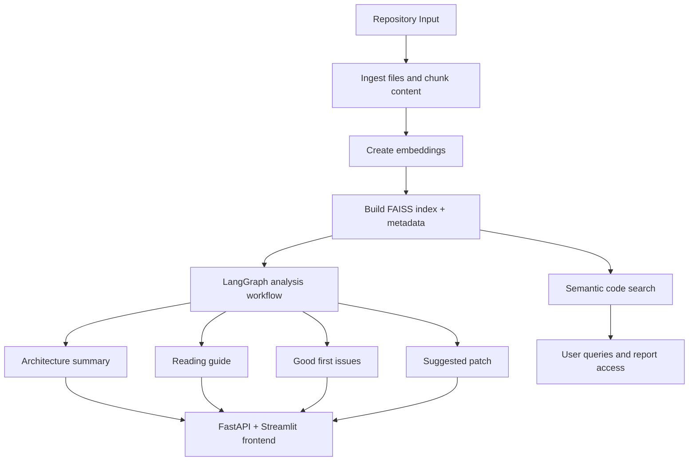
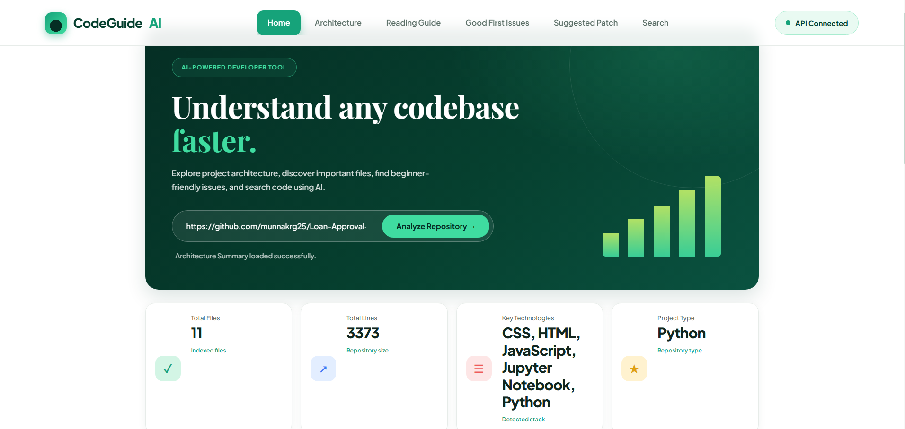
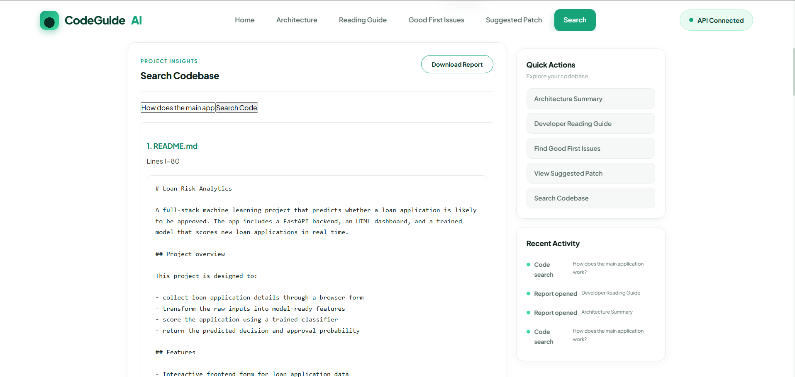

# Codebase Onboarding Assistant

A practical repository onboarding tool designed to help a developer understand an unfamiliar codebase faster. The project combines repository ingestion, semantic code search, and AI-generated summaries to support onboarding, code exploration, and early contribution work.

## 1. Project Overview

When a developer is introduced to a new repository, the first challenge is often not the logic itself but understanding where to start. This project helps reduce that friction by scanning a repository, splitting source files into smaller chunks, indexing them for semantic search, and producing onboarding materials such as architecture summaries, reading guides, and beginner-friendly issue suggestions.

The workflow is intended to support learning and contribution in a practical way. It does not replace manual code review, but it makes it easier to identify important files, search for specific concepts, and get a quick overview of how a project is structured.

## 2. Key Features

The project currently includes the following features, based on the implemented code:

- Repository ingestion for supported file types from a local path or Git URL.
- Chunking of repository content into smaller text windows for indexing.
- Embedding generation using Sentence Transformers.
- FAISS-based similarity search for natural-language code queries.
- Repository statistics calculation for files, line counts, size, and detected technologies.
- Architecture summary generation using Google Gemini.
- Reading guide generation for project onboarding.
- Beginner-friendly issue suggestions based on indexed repository content.
- Suggested patch generation for a selected file, without modifying the source repository.
- LangGraph workflow orchestration for sequential analysis steps.
- FastAPI endpoints for repository analysis, report retrieval, and code search.
- Streamlit dashboard for interactive use in the browser.

## 3. How It Works

The system follows a straightforward workflow from repository input to generated onboarding output.



In practice, the project reads repository files, creates searchable chunks, converts them into embeddings, indexes the vectors, and then runs AI-powered analysis to generate useful onboarding documentation.

## 4. Technology Stack

| Category | Technology |
|---|---|
| Language | Python |
| Workflow orchestration | LangGraph |
| API framework | FastAPI |
| Data validation | Pydantic |
| Vector database | FAISS |
| Embedding model | Sentence Transformers |
| Git access | GitPython |
| AI generation | Google Gemini / `google-genai` |
| Frontend UI | FastAPI |
| Testing | pytest |
| Environment management | uv |
| Dependency support | Python-dotenv |

The implementation in this repository uses the technologies above directly in the codebase.

## 5. Project Architecture

```text
Codebase Onboarding Assistant/
├── app.py                              # Streamlit dashboard for interactive use
├── backend/
│   ├── __init__.py
│   ├── api.py                          # FastAPI endpoints for analysis, reports, and search
│   ├── main.py                        # CLI entry point for ingestion, indexing, and analysis
│   ├── nodes/
│   │   ├── __init__.py
│   │   ├── embed.py                   # Build embeddings from chunked repository data
│   │   ├── ingest.py                  # Scan repository and create chunk records
│   │   ├── issue_generator.py         # Generate beginner-friendly issues
│   │   ├── patch_suggester.py         # Generate suggested patch recommendations
│   │   ├── reading_guide.py           # Produce a project reading guide
│   │   ├── retrieve.py                # Search code using embedding similarity
│   │   ├── summarize.py               # Generate architecture summary with Gemini
│   │   ├── workflow.py                # LangGraph orchestration for the analysis pipeline
│   │   └── ...
│   ├── schemas/
│   │   ├── __init__.py
│   │   └── workflow_state.py          # Typed workflow state for the analysis graph
│   └── utils/
│       ├── __init__.py
│       ├── chunker.py                 # Split file content into chunks with overlap
│       ├── faiss_index.py             # Save/load FAISS index and metadata
│       └── repo_utils.py              # Local repository opening and Git URL cloning helper
├── frontend/
│   ├── index.html
│   ├── script.js
│   └── style.css
├── indexes/
│   ├── faiss.index                    # Generated FAISS vector index
│   └── metadata.json                  # Metadata aligned with the FAISS index
├── outputs/
│   ├── architecture_summary.md
│   ├── good_first_issues.md
│   ├── reading_guide.md
│   ├── suggested_patch.md
│   └── repository_stats.json
├── samples/
│   └── chunks.jsonl                   # Generated repo chunks database
├── tests/
│   ├── test_chunker.py
│   ├── test_faiss_index.py
│   └── test_retrieve.py
├── .env                               # Local environment configuration (not committed in some setups)
├── requirements.txt
├── README.md
├── .gitignore
└── ...
```

Important implementation files:

- `backend/main.py`: CLI entry point for each pipeline action.
- `backend/api.py`: FastAPI app that exposes repository analysis and search endpoints.
- `backend/nodes/ingest.py`: repository scanning and chunk creation.
- `backend/nodes/embed.py`: embedding generation and index creation.
- `backend/nodes/retrieve.py`: semantic search across indexed chunks.
- `backend/nodes/workflow.py`: sequential onboarding workflow using LangGraph.
- `app.py`: Streamlit dashboard UI for interactive repository analysis.
- `backend/utils/faiss_index.py`: persistence logic for FAISS index and metadata.
- `tests/`: focused validation for chunking, index serialization, and search input checks.

## 6. Prerequisites

Before running the project, make sure you have the following installed:

- Python 3.11+ (the project is built around standard Python and was designed for local development)
- `uv` for dependency management and virtual environment setup
- Git, if you want to analyze a remote repository or clone a project locally
- A Google Gemini API key for the AI-powered report generation steps

The project expects a valid environment variable for Gemini access before generating architecture summaries, reading guides, issue suggestions, and patch suggestions.

## 7. Installation and Setup

The following commands are based on the actual project setup and use Windows PowerShell with a virtual environment and `uv`.

### 1. Clone the repository

```powershell
git clone <your-repository-url>
cd "Codebase Onboarding Assistant"
```

### 2. Create and activate a venv

```powershell
uv venv --python 3.12
.\.venv\Scripts\Activate.ps1
```

### 3. Install dependencies

```powershell
uv pip install -r requirements.txt
```

### 4. Confirm the project is ready

```powershell
python --version
python -m pytest -q
```

The tests in this project are small and focused on chunking, FAISS serialization, and search validation.

## 8. Environment Variables

Create a `.env` file in the project root before generating AI reports.

Example template:

```env
GEMINI_API_KEY=your_api_key_here
GEMINI_MODEL=gemini-2.5-flash
```

The code checks for `GEMINI_API_KEY` and also accepts `GOOGLE_API_KEY` as a fallback in `backend/api.py`. Do not commit your real key, and do not include secrets in source control or screenshots.

## 9. Usage Examples

The CLI commands below match the actual implementation in `backend/main.py`.

### 1. Ingest a repository into chunks

```powershell
python -m backend.main ingest --repo "C:\path\to\your\repository" --out samples/chunks.jsonl
```

This step reads supported files, skips common build folders, and saves chunked content to `samples/chunks.jsonl`.

### 2. Build embeddings and the FAISS index

```powershell
python -m backend.main embed --chunks samples/chunks.jsonl --index indexes/faiss.index --meta indexes/metadata.json
```

### 3. Search repository code using natural language

```powershell
python -m backend.main search --query "Where are HTTP requests sent?" --index indexes/faiss.index --meta indexes/metadata.json --top-k 3
```

The search logic loads the saved FAISS index and metadata and returns the most relevant code chunks.

### 4. Generate an architecture summary

```powershell
python -m backend.main summarize --meta indexes/metadata.json --out outputs/architecture_summary.md
```

### 5. Generate the reading guide

```powershell
python -m backend.main guide --meta indexes/metadata.json --out outputs/reading_guide.md
```

### 6. Generate good first issue suggestions

```powershell
python -m backend.main issues --meta indexes/metadata.json --out outputs/good_first_issues.md
```

### 7. Generate a patch suggestion for a file

```powershell
python -m backend.main patch --file backend/main.py --meta indexes/metadata.json --out outputs/suggested_patch.md
```

The patch suggestion feature is meant for review, not automatic application.

### 8. Run the full workflow

```powershell
python -m backend.main analyze --meta indexes/metadata.json --out outputs/architecture_summary.md
```

This runs the LangGraph workflow that validates metadata and produces the repository onboarding artifacts.

## 10. Sample Output

The examples below are illustrative and reflect the structure of the project output rather than a guaranteed real repository result.

### Example architecture summary snippet

```md
## 1. Project Overview
This project helps developers understand a codebase by generating an architecture overview and onboarding guides.

## 2. Tech Stack
- Python
- FastAPI
- FAISS
- Sentence Transformers
- Gemini

## 3. Key Files
- backend/main.py: CLI entry point
- backend/api.py: API routes for reports and search
- app.py: Streamlit dashboard
```

### Example code search output

```text
Result 1
File: backend/main.py
Lines: 10-120
Score: 0.8124
Code:
... repository ingestion and CLI routing logic ...
```

These examples are intended to show the expected output style and structure, not to claim that a specific repository produces exactly these values.

## Demo Screenshots

The screenshots below are illustrative demo mockups for presentation use. They show the expected user flow for repository analysis, search, and onboarding output generation without claiming to be a live capture of a specific repository.

### Dashboard overview



### Search and result view



## 11. Output Files

This project generates several files in the repository root after analysis:

| Path | Purpose |
|---|---|
| `samples/chunks.jsonl` | Chunked repository content ready for embedding |
| `indexes/faiss.index` | Vector index used for semantic similarity search |
| `indexes/metadata.json` | Metadata linked to the FAISS index |
| `outputs/architecture_summary.md` | Generated repository overview |
| `outputs/reading_guide.md` | Beginner-oriented reading guide |
| `outputs/good_first_issues.md` | Contributor-friendly issue ideas |
| `outputs/suggested_patch.md` | Suggested patch for review |
| `outputs/repository_stats.json` | Saved repository statistics |

These files are created during the workflow and are expected to be regenerated when a new repository is analyzed.

## 12. Testing Instructions

The project includes a small pytest suite for validation.

Run the tests from the project root:

```powershell
python -m pytest -q
```

Or run with more output:

```powershell
python -m pytest -v
```

Current tests cover:

- chunk splitting logic in `tests/test_chunker.py`
- FAISS save/load behavior in `tests/test_faiss_index.py`
- empty-query validation in `tests/test_retrieve.py`

## 13. Security and Limitations

This project is useful for onboarding and exploration, but it has important limitations:

- API keys must be protected and should not be hardcoded into source files or pushed to public repositories.
- The project reads local repository content and may clone or access remote Git URLs depending on the input source.
- Semantic search and AI-generated summaries depend on model quality, prompt design, and available context.
- The architecture and contributor suggestions are generated from indexed chunks, so they are only as reliable as the available repository data.
- Suggested patch content is for review only. It must not be applied or pushed automatically unless a separate, explicit implementation is added.
- Some generated results may be incomplete or uncertain if the repository is large, poorly structured, or missing key files.

## 14. Future Improvements

The following ideas are realistic next steps for this project, but they are not currently implemented as a complete feature set:

- Better repository validation for unsupported project structures.
- Deeper technology detection and project-specific metadata extraction.
- Improved ranking and evaluation of semantic search results.
- More durable workflow error handling for missing files and failed AI requests.
- Better GitHub URL analysis with repository cloning and validation improvements.
- Automatic comparison of generated patch suggestions with test execution results.
- Expanded QA coverage and CI automation for Windows, Linux, and macOS.

## 15. Learning Outcomes and Skills Demonstrated

This project demonstrates a combination of practical software engineering skills:

- Python application design and modular code organization
- CLI development with `argparse`
- API development with FastAPI
- Data processing and chunk-based indexing workflow
- Embedding generation and vector search with FAISS and Sentence Transformers
- AI-assisted repository analysis using Gemini
- Workflow orchestration with LangGraph
- UI integration with Streamlit
- Testing and validation using pytest
- Repository-based project onboarding and developer tooling design

## 16. Contribution Guidelines

Contributions are welcome if they are thoughtful and aligned with the purpose of the project.

- Open an issue before proposing a major feature change.
- Keep changes focused and easy to review.
- Update or add tests when modifying key logic.
- Prefer small, well-documented improvements.
- Ensure the code still works with the existing CLI and backend structure.
- Do not commit secrets or API keys.

Before submitting a contribution, it is recommended to run the current test suite and confirm the relevant functionality still behaves as expected.

## 17. License

MIT

## 18. Author

```text
Name: Munna Kumar
```

## 19. Summary

This project is a beginner-friendly but practical repository onboarding tool for exploring unfamiliar codebases. It uses repository scanning, embeddings, and AI-assisted analysis to help developers identify key files, ask natural-language questions about the code, and understand the structure of a project more quickly.

It is especially useful for students, junior developers, and contributors who need a simple way to start learning a repository without reading every file manually.
